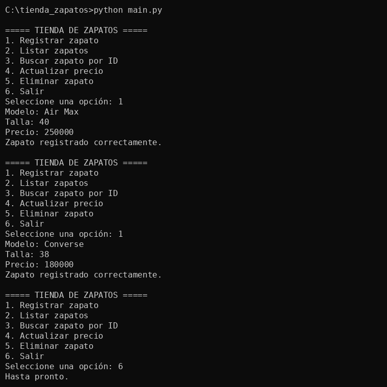
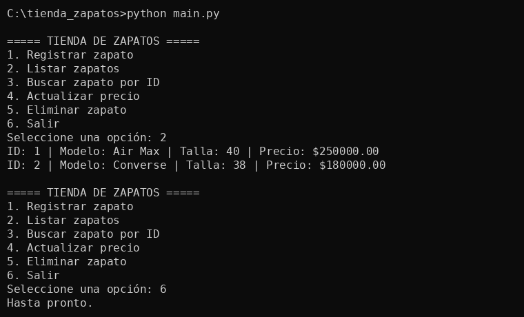
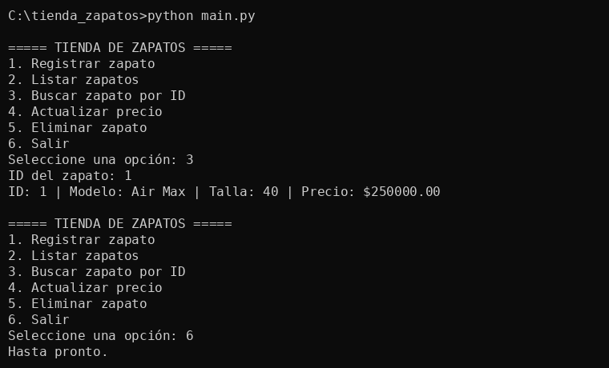
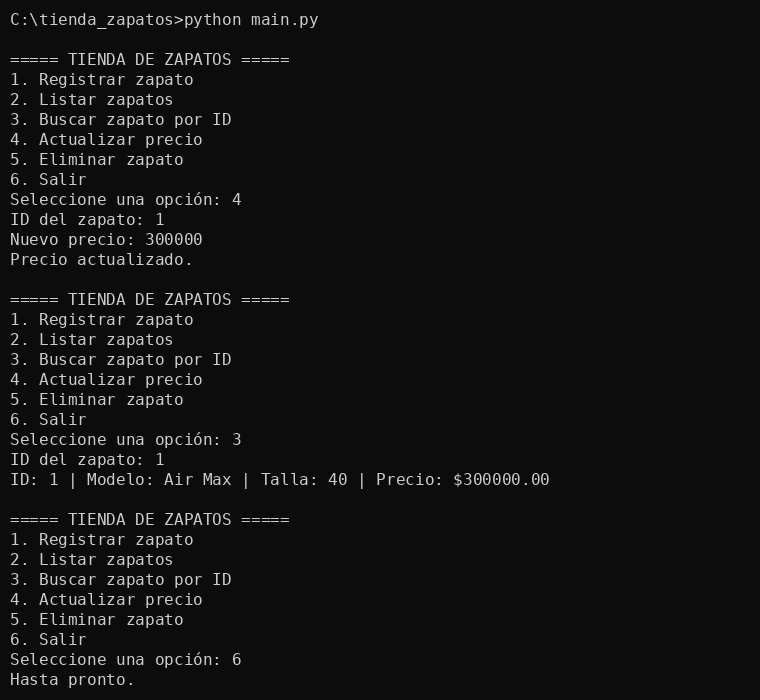
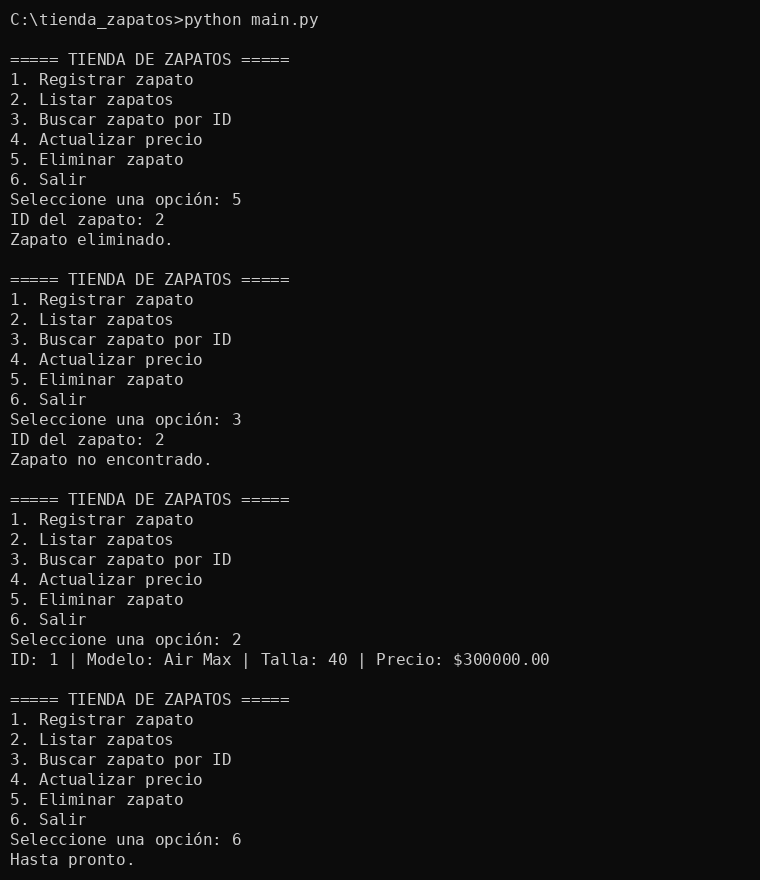
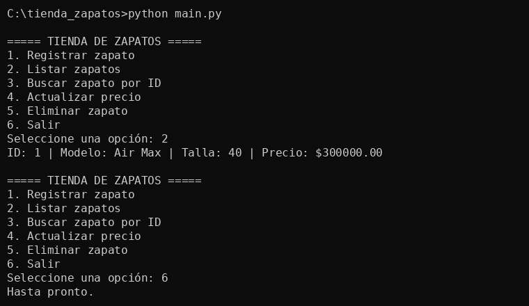
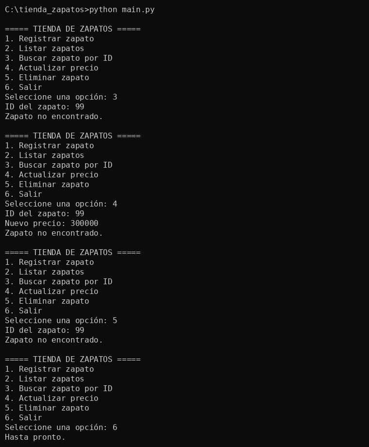

# Sistema de Inventario de Zapatos — SQLAlchemy ORM

## 1. Información del proyecto

| Información | Descripción |
|---|---|
| Estudiante | [Nombre completo] |
| Asignatura | [Nombre de la asignatura] |
| Docente | [Nombre del docente] |
| Fecha | [Fecha de entrega] |
| Lenguaje de programación | Python |
| ORM utilizado | SQLAlchemy |
| Base de datos | SQLite |

## 2. Descripción del proyecto

**¿En qué consiste el programa?**

Es una aplicación de consola para manejar el inventario de una tienda de zapatos. Guarda el modelo, la talla y el precio de cada zapato en una base de datos SQLite, así la información no se pierde al cerrar el programa. Para trabajar con la base de datos se usa SQLAlchemy como ORM, es decir, se manejan objetos de Python en vez de escribir SQL a mano.

**¿Qué funcionalidades tiene?**

- Registrar zapatos.
- Consultar el inventario.
- Buscar zapatos por ID.
- Actualizar precios.
- Eliminar zapatos.

## 3. Estructura del proyecto

```text
tienda_zapatos/
├── main.py
├── datos.py
├── requirements.txt
├── README.md
└── evidencias/
```

**Explicación de los archivos:**

| Archivo | ¿Cuál es su responsabilidad? |
|---|---|
| `main.py` | Tiene el menú y pide los datos al usuario. Llama a las funciones de `datos.py`. |
| `datos.py` | Tiene la conexión, el modelo `Zapato` y las funciones del CRUD con SQLAlchemy. |
| `requirements.txt` | Lista la dependencia necesaria (SQLAlchemy 2.x). |
| `zapateria.db` | Es la base de datos SQLite. Se genera sola la primera vez que se ejecuta el programa, en la misma carpeta. |

## 4. Instalación y ejecución

**Paso 1. Requisitos**

Tener Python 3 instalado (con pip).

**Paso 2. Instalación de dependencias**

```bash
python -m pip install -r requirements.txt
```

**Paso 3. Ejecución**

```bash
python main.py
```

**Paso 4. Resultado esperado**

Aparece el menú "TIENDA DE ZAPATOS" con las 6 opciones. Se crea el archivo `zapateria.db` y se puede registrar, listar, buscar, actualizar y eliminar zapatos.

---

# 5. Documentación técnica — Preguntas obligatorias

### Pregunta 1. Modelo y tabla

**Respuesta:**

La clase `Zapato` es la que representa la tabla. Hereda de `Base`, que a su vez hereda de `DeclarativeBase`. SQLAlchemy saca el nombre de la tabla del atributo `__tablename__` ("zapatos") y cada columna sale de los atributos que se declaran con `Mapped` y `mapped_column`: `id`, `modelo`, `talla` y `precio`. El tipo de la columna se toma del tipo de Python (`int` es entero, `str` es texto y `float` es real).

**Fragmento de código relacionado:**

```python
class Zapato(Base):
    __tablename__ = "zapatos"

    id: Mapped[int] = mapped_column(primary_key=True, autoincrement=True)
    modelo: Mapped[str] = mapped_column(String)
    talla: Mapped[int] = mapped_column()
    precio: Mapped[float] = mapped_column()
```

El `id` es clave primaria y se genera solo cada vez que se registra un zapato.

### Pregunta 2. Creación de la base de datos

**Respuesta:**

Al ejecutar el programa por primera vez, `main()` llama a `datos.inicializar_bd()`. Esa función usa `Base.metadata.create_all(engine)`, que revisa los modelos que heredan de `Base` y crea las tablas que no existan. Como el engine apunta a `sqlite:///zapateria.db`, SQLite crea el archivo `zapateria.db` si no existe y dentro queda la tabla `zapatos`. Si ya existe, no la borra ni la vuelve a crear.

**Fragmento de código relacionado:**

```python
engine = create_engine("sqlite:///zapateria.db")

def inicializar_bd():
    Base.metadata.create_all(engine)
```

### Pregunta 3. Registro de zapatos

**Respuesta:**

1. En `main.py` el usuario elige la opción 1 y escribe modelo, talla y precio.
2. `main()` convierte la talla a `int` y el precio a `float`, y valida que no estén vacíos ni sean menores o iguales a 0.
3. Llama a `datos.crear_zapato(modelo, talla, precio)`.
4. Esa función crea un objeto `Zapato`, abre una sesión, lo agrega con `session.add()` y hace `session.commit()`. En ese momento SQLAlchemy genera el INSERT y el dato queda en `zapateria.db`.
5. Devuelve `True` y el menú muestra "Zapato registrado correctamente."

**Fragmento de código relacionado:**

```python
def crear_zapato(modelo, talla, precio):
    zapato = Zapato(modelo=modelo, talla=talla, precio=precio)
    with Session(engine) as session:
        session.add(zapato)
        session.commit()
    return True
```

### Pregunta 4. Sesiones y transacciones

**Respuesta:**

La sesión es el medio por el que el programa habla con la base de datos: ahí se agregan, consultan, modifican y eliminan los objetos, y guarda los cambios pendientes en una transacción. En el código se abre con `with Session(engine) as session`, y así se cierra sola al terminar el bloque.

Si agrego o modifico un objeto pero no hago `commit()`, los cambios no se guardan en la base de datos. Al cerrar la sesión se hace rollback y se pierden. Por ejemplo, en `crear_zapato` sin el `commit()` el programa diría que se registró, pero al listar no aparecería nada.

### Pregunta 5. Búsqueda por ID

**Respuesta:**

La función `buscar_zapato` abre una sesión y usa `session.get(Zapato, id_zapato)`, que busca por clave primaria. Si encuentra el registro devuelve el objeto `Zapato` con sus datos, y `main.py` lo muestra con `mostrar_zapato`. Si no existe devuelve `None`, y el menú muestra "Zapato no encontrado."

**Fragmento de código relacionado:**

```python
def buscar_zapato(id_zapato):
    with Session(engine) as session:
        return session.get(Zapato, id_zapato)
```

### Pregunta 6. Actualización de precios

**Respuesta:**

Primero se obtiene el objeto con `session.get`. Si no existe se devuelve `False`. Si existe, se cambia el atributo directamente (`zapato.precio = nuevo_precio`); la sesión detecta ese cambio y con `session.commit()` genera el UPDATE y lo guarda. Al final devuelve `True`.

**Fragmento de código relacionado:**

```python
def actualizar_precio(id_zapato, nuevo_precio):
    with Session(engine) as session:
        zapato = session.get(Zapato, id_zapato)
        if zapato is None:
            return False
        zapato.precio = nuevo_precio
        session.commit()
        return True
```

### Pregunta 7. Eliminación de registros

**Respuesta:**

Se busca el zapato por ID. Si existe, se elimina con `session.delete(zapato)` y se confirma con `commit()`, lo que ejecuta el DELETE en la base de datos. Para comprobar que ya no existe, lo busco de nuevo con la opción 3 o listo todos con la opción 2: el programa responde "Zapato no encontrado." o ya no aparece en la lista.

**Fragmento de código relacionado:**

```python
def eliminar_zapato(id_zapato):
    with Session(engine) as session:
        zapato = session.get(Zapato, id_zapato)
        if zapato is None:
            return False
        session.delete(zapato)
        session.commit()
        return True
```

### Pregunta 8. Persistencia de datos

**Respuesta:**

Los zapatos siguen ahí al cerrar y volver a abrir el programa porque no se guardan en variables o listas de Python (que se borran al terminar), sino en el archivo `zapateria.db`, que queda en el disco. Cuando se vuelve a ejecutar, `create_all` ve que la tabla ya existe y no la toca, así que al listar aparecen los registros que quedaron. Lo comprobé cerrando el programa con la opción 6, abriéndolo otra vez y listando: el zapato que había dejado seguía registrado.

---

## 6. Pruebas de funcionamiento y evidencias

### Prueba 1. Registrar zapatos

- **Acción realizada:** registrar dos zapatos.
- **Datos utilizados:** Air Max, talla 40, precio 250000; Converse, talla 38, precio 180000.
- **Resultado obtenido:** el programa mostró "Zapato registrado correctamente." en los dos casos.

**Evidencia:**



### Prueba 2. Listar inventario

- **Acción realizada:** consultar todos los zapatos.
- **Resultado obtenido:** mostró los dos zapatos con su ID (1 y 2), modelo, talla y precio.

**Evidencia:**



### Prueba 3. Buscar por ID

- **ID utilizado:** 1.
- **Resultado obtenido:** mostró el zapato Air Max, talla 40, precio $250000.00.

**Evidencia:**



### Prueba 4. Actualizar precio

- **Zapato seleccionado:** Air Max (ID 1).
- **Precio anterior:** 250000.
- **Precio nuevo:** 300000.
- **Resultado obtenido:** mostró "Precio actualizado." y al buscarlo de nuevo salió con $300000.00.

**Evidencia:**



### Prueba 5. Eliminar zapato

- **ID eliminado:** 2 (Converse).
- **Resultado obtenido:** mostró "Zapato eliminado.". Después busqué el ID 2 y salió "Zapato no encontrado.", y al listar solo quedó el Air Max.

**Evidencia:**



### Prueba 6. Comprobar persistencia

- **Acción realizada:** cerrar y ejecutar nuevamente el programa.
- **Resultado obtenido:** al listar, el Air Max (ID 1, $300000.00) seguía guardado.

**Evidencia:**



### Pruebas con registros inexistentes

Probé con el ID 99, que no existe.

| Operación | ¿Qué sucedió? |
|---|---|
| Buscar ID inexistente | `buscar_zapato` devolvió `None` y el programa mostró "Zapato no encontrado." |
| Actualizar ID inexistente | `actualizar_precio` devolvió `False` y mostró "Zapato no encontrado." |
| Eliminar ID inexistente | `eliminar_zapato` devolvió `False` y mostró "Zapato no encontrado." |

**Evidencia:**



## 7. Conclusiones

1. Aprendí a hacer un CRUD completo con SQLAlchemy usando objetos de Python y sesiones, y entendí que los cambios solo se guardan al hacer `commit()`.
2. Con el ORM trabajo con objetos y atributos (por ejemplo `zapato.precio = ...`) y no tengo que escribir las sentencias INSERT, SELECT, UPDATE o DELETE; con SQL directo hay que escribir cada consulta a mano.
3. La principal dificultad fue entender cómo funcionan las sesiones y cuándo se guardan los cambios. Lo solucioné probando el programa y revisando que los datos siguieran ahí después de cerrarlo.
